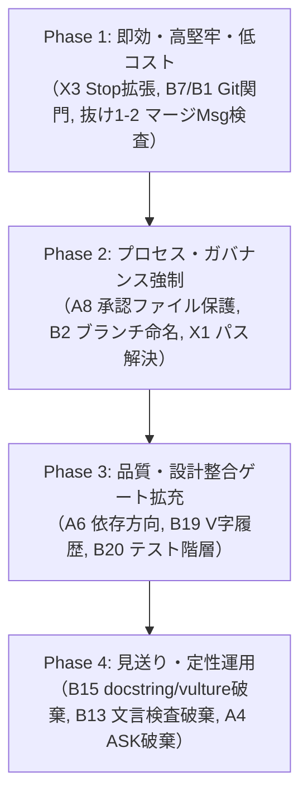

独立レビュアーとして、`/tmp/claude-1000/-home-tomo-project-cheeze-gyudon/fe52b292-861d-43e7-b105-b8a8584da814/scratchpad/gate_inventory.md`（関所の棚卸し表 v1）に対するレビュー結果を報告します。
なお、指示に従い読み取り専用で精査しており、対象ファイルやリポジトリの変更は一切行っていません。

---

# 関所の棚卸し表 (gate_inventory.md) レビューレポート

---

## 観点1: 抜け（原典に書かれた規則で、表に載っていない関所候補）

### 1-1. 委譲エージェントの結果受取時の「ゲート再実行強制（自己申告を信用しない）」
- **重大度**: 高
- **根拠**: [CLAUDE.md](file:///home/tomo/.claude/CLAUDE.md#L56-L57)
  > `委譲したエージェントは別worktree・別ブランチで作業させ、受け取る側がゲートを自分で再実行する（自己申告を信用しない）。`
- **指摘と修正案**:
  表の B10 では「委譲エージェントは別worktree・別ブランチ」が取り上げられていますが、「委譲結果を受け取る親エージェントが自らゲートを再実行したか」を担保する関門が完全に抜けています。子エージェントは「テストを通しました」と虚偽の自己申告をする傾向があるため、親側がマージ前に自環境で `scripts/gate.sh` を実行した履歴がない場合、マージや終了をブロックする関所が必要です。

### 1-2. マージメッセージにおける「要件→証拠」フォーマットの検証
- **重大度**: 中
- **根拠**: [CLAUDE.md](file:///home/tomo/.claude/CLAUDE.md#L57)
  > `マージメッセージに要件→証拠を書く。`
- **指摘と修正案**:
  B7 で `merge-to-main.sh` の使用を強制する提案がありますが、同スクリプトに第2引数として渡される `<msg-file>` の内容検査が棚卸しされていません。`merge-to-main.sh` 内でマージメッセージファイルを読み、要件ID（`REQ-...`）やテスト実行結果・証拠のセクションが存在するかを正規表現でチェックするゲートを関所として追加すべきです。

### 1-3. 承認ファイル (`approval.json`) の有効性（state: open）の維持規則
- **重大度**: 中
- **根拠**: [matome/AGENT.md](file:///home/tomo/project/matome/AGENT.md#L5)
  > `A change to src/ together with tests or specs needs a human-approved design: .specs/<REQ>/approval.json with state open.`
- **指摘と修正案**:
  A8 では「承認ファイルは人間が作る」ことのみを挙げていますが、原典では「state が open であること」が明示されています。すでに closed や withdrawn になった過去の承認ファイルが存在する場合、それを流用して `src/` を改変することを防ぐ必要があります（`gov check` 側には実装がありますが、棚卸し表上の要件定義として明記が抜けています）。

### 1-4. ゴールデン・実データ出力差分の許容範囲内チェック
- **重大度**: 低
- **根拠**: [CLAUDE.md](file:///home/tomo/.claude/CLAUDE.md#L56)
  > `ゴールデン・実データ出力の差分が許容範囲内`
- **指摘と修正案**:
  リファクタリングや挙動不変を謳うブランチにおいて極めて重要な検証項目ですが、表に記載がありません。機械判定の可否を含め、「スナップショットテストとしてゲート化する」か「機械化しない（人間の確認）」のいずれかに分類して記載すべきです。

### 1-5. 設計・判断資料の定性規則の棚卸し漏れ（機械化しない枠への追加）
- **重大度**: 低
- **根拠**: [CLAUDE.md](file:///home/tomo/.claude/CLAUDE.md#L68-L70)
  > `測った対象を正確に書く`
  > `実例と定義の整合を確認`
  > `ユーザーの過去の決定を変える提案は、そうと明記する`
- **指摘と修正案**:
  表の B17 は「根拠ラベルと再計算」のみを抽出していますが、上記3点は設計精度セクションの重要な規則です。これらは自然言語の意味理解を伴うため「機械化しない」枠に明記して棚卸しを完全にする必要があります。

---

## 観点2: 誤り（「機械判定」「現状」と既存フック実装の食い違い）

### 2-1. X1: 「他レポのパスでの編集は判定対象外」という現状認識の誤り
- **重大度**: 高
- **根拠**: [branch_guard.sh](file:///home/tomo/.claude/hooks/branch_guard.sh#L8-L18)
  ```bash
  8: else
  9:   path=$(printf '%s' "$input" | jq -r '.tool_input.file_path // .tool_input.notebook_path // ""')
  10:   [ -z "$path" ] && exit 0
  11:   dir=$(dirname "$path"); while [ ! -d "$dir" ] && [ "$dir" != "/" ]; do dir=$(dirname "$dir"); done
  ...
  17: branch=$(git -C "$dir" branch --show-current)
  18: case "$branch" in main|master) ;; *) exit 0 ;; esac
  ```
- **指摘と修正案**:
  表の X1 に「フックが『セッションの cwd のリポジトリ』しか見ない。git -C <dir> や他レポのパスでの編集は判定対象外」とありますが、**これは事実と異なります**。
  `branch_guard.sh` は `Edit|Write|NotebookEdit` の場合、`cwd` ではなく編集対象ファイルのパス（`tool_input.file_path`）から親ディレクトリを遡って `git -C "$dir"` で対象リポジトリのブランチを判定しています。
  cwd しか見ていないのは Bash コマンド（`git commit`）のハンドリング部分（L7）です。現状認識を「Bash の git コマンドは cwd しか解釈しないが、Edit/Write ツールは対象ファイルのパスからリポジトリを解決している（ただし相対パス時の基準ディレクトリ問題等の課題はある）」と訂正すべきです。

### 2-2. A1: AGENT.md の「ツールはまだ止めない」は陳腐化ではなく現行実装そのもの
- **重大度**: 高
- **根拠**: [claude_hook.py](file:///home/tomo/project/cheeze_gyudon/src/jtc_gov/adapters/claude_hook.py#L59-L64) および L95-96
  ```python
  59: def _notice(repo: Repo, root: Path, payload: dict[str, object]) -> HookOutcome:
  60:     path = _written_path(root, payload.get("tool_input"))
  61:     if path is None or not path.startswith(SRC_PREFIX) or len(valid_open(repo, "base")) == 1:
  62:         return HookOutcome(0)
  63:     return HookOutcome(0, stdout=f"{short_status(repo)}\n{APPROVAL_NOTICE}")
  ...
  95:     if payload.get("tool_name") in WRITE_TOOLS:
  96:         return _notice(repo_factory(root, WORKTREE), root, payload)
  ```
  [cheeze_gyudon/AGENT.md](file:///home/tomo/project/cheeze_gyudon/AGENT.md#L5)
  > `The tooling does not stop you yet (.specs/REQ-2026-010/background/as_is_inventory.md); follow this rule yourself.`
- **指摘と修正案**:
  表の A1 に「cheeze_gyudon の AGENT.md は『ツールはまだ止めない』と書くが REQ-2026-010 の導入後は陳腐化の疑い [推論]」とありますが、**陳腐化しておらず現行実装を正しく表しています**。
  `claude_hook.py` の `_notice` は `HookOutcome(0, ...)`（exit code 0）を返しており、標準出力に注意を出すだけで **Edit/Write の実行を一切ブロックしていません**。ブロックするのはコミットまたはプッシュ時のみです（`_gate` で `REJECTING_RULES = ("K.", "D.")` の場合のみ exit 2、L26, 68-70）。
  したがって「現状: gov K」ではなく「現状: コミット/プッシュ時のみ gov K でブロック。Edit/Write 実行時は警告のみで止めない」が正確です。

### 2-3. A4: 「現状: gov T(印)のみ」の誤り
- **重大度**: 中
- **根拠**: [checks/t.py](file:///home/tomo/project/cheeze_gyudon/src/jtc_gov/checks/t.py#L1-L47) および [claude_hook.py](file:///home/tomo/project/cheeze_gyudon/src/jtc_gov/adapters/claude_hook.py#L23)
  ```python
  23: REJECTING_RULES: Final = ("K.", "D.")
  ```
- **指摘と修正案**:
  `checks/t.py`（gov T）はテスト関数に `@pytest.mark.requirement` タグが付与されているか、その要件が仕様書に存在するかを検査するものであり、「テストを弱めていないか（assertや期待値の変更）」は**一切検査していません**。
  さらに、`claude_hook.py` においてブロック対象（exit 2）なのは `K.` と `D.` のみで、`T.` は単なる警告（exit 0）として出力されるだけです。したがって「現状: gov T(印)のみ」は二重に誤りであり、「現状: なし」と改めるべきです。

### 2-4. B16: 「現状: なし(ruff 未設定の疑い [推論])」の食い違い
- **重大度**: 中
- **根拠**: [cheeze_gyudon/pyproject.toml](file:///home/tomo/project/cheeze_gyudon/pyproject.toml#L53-L67), [matome/pyproject.toml](file:///home/tomo/project/matome/pyproject.toml#L56-L60)
  ```toml
  # cheeze_gyudon/pyproject.toml
  select = ["ALL"]
  # (tests/**/* のみ PLR2004 を ignore)

  # matome/pyproject.toml
  ignore = [ ..., "PLR2004", ... ]
  ```
- **指摘と修正案**:
  `cheeze_gyudon` では `select = ["ALL"]` が指定され、`src/` 配下では既に `PLR2004`（マジックナンバー検出）が有効化されており、品質ゲートで弾かれます。一方 `matome` では `ignore` に明示的に入れられています。「ruff 未設定」ではなく、「cheeze_gyudon では既に設定済み、matome では明示的に無効化（ignore）されている」が正確な現状です。

### 2-5. B20: 「現状: gov(レポごと)」「提案: 維持」の過大評価
- **重大度**: 中
- **根拠**: [checks/t.py](file:///home/tomo/project/cheeze_gyudon/src/jtc_gov/checks/t.py#L38-L40), [checks/d.py](file:///home/tomo/project/cheeze_gyudon/src/jtc_gov/checks/d.py#L1-L100)
- **指摘と修正案**:
  原典（CLAUDE.md L77）には「tests/e2e|integration|unit、`--strict-markers`、設計のないモジュールを落とす」とありますが、現行の gov は `tests/` 直下にあるか（T.c）とタグ形式（T.a/b）しか見ておらず、ディレクトリ階層（e2e/integration/unit）の強制、`--strict-markers` の強制、設計のない `src/` モジュールの検出は**実装されていません**。これを「現状: gov」「提案: 維持」とするのは過大評価であり、未実装項目としてゲート拡充対象に挙げるべきです。

---

## 観点3: 実現可能性（Claude Code フックの仕様・限界、回避の穴）

### 3-1. B13: Stop フックでの「最後の応答文言検査」は会話を破綻させる（致命的欠陥）
- **重大度**: 高
- **根拠**: Claude Code フック仕様、および [stop_gate.sh](file:///home/tomo/.claude/hooks/stop_gate.sh#L5-L10)
- **指摘と修正案**:
  - **仕様上の欠陥**: `Stop` フックは、エージェントが作業を終えてユーザーに質問や確認を投げかけるターン（途中の一時停止）でも必ず発火します。エージェントが「この方針で進めてよいですか？」とユーザーに確認しようとした際、最後の応答に「受け入れ待ち/マージ済み」や「純増減」が含まれていないとして exit 2 で差し戻すと、**エージェントはユーザーに返答できず無限ループまたは自滅（3回ブロックで NOT DONE 終了）に陥ります**。
  - **入力の限界**: `Stop` フックの標準入力 JSON には、エージェントが生成したテキスト本文が直接含まれていません（transcript.jsonl を自前でパースする必要があります）。
  - **修正案**: 応答テキストの文字列検査による Stop 遮断は**撤回すべき**です。純増減や完了報告の検証は、Stop 時ではなく `merge-to-main.sh` のマージメッセージ検査、またはコミット時の検査として行うのが確実です。

### 3-2. Bash コマンド文字列解析に依存するフック（B7, B9, A8 等）の容易なバイパス
- **重大度**: 高
- **根拠**: [block_git_add_all.sh](file:///home/tomo/.claude/hooks/block_git_add_all.sh#L3-L5), [claude_hook.py](file:///home/tomo/project/cheeze_gyudon/src/jtc_gov/adapters/claude_hook.py#L18-L20)
- **指摘と修正案**:
  - PreToolUse(Bash) でコマンド文字列を正規表現で監視して `git push` や `git merge`、`approval.json` への変更をブロックしようとしても、シェル構文の柔軟性により容易にすり抜けます。
    - **具体例1 (スクリプト経由)**: `echo "git push origin main" > /tmp/p.sh && bash /tmp/p.sh` （フックには `bash /tmp/p.sh` しか見えない）
    - **具体例2 (他言語ワンライナー)**: `python3 -c "import subprocess; subprocess.run(['git', 'push'])"`
    - **具体例3 (エイリアス・環境変数・改行)**: `G=git; $G push`, `\git push`, `env git push`
    - **具体例4 (リダイレクト・ヒアドキュメント)**: `cat << 'EOF' > .specs/REQ-001/approval.json` （Bash コマンド文字列からリダイレクト先パスを確実に抽出するのは極めて困難）
  - **修正案**:
    Git 操作の遮断（main へのマージや push）は、Claude Code の Bash フックだけに頼るのではなく、**Git 自体のフック（`.git/hooks/pre-push`, `pre-commit`）** に組み込むか、リモート側の branch protection で強制するのが最も堅牢です。

### 3-3. B10: Agent ツールの isolation パラメータ検査の困難性
- **重大度**: 中
- **根拠**: [settings.json](file:///home/tomo/.claude/settings.json#L79-L81)
- **指摘と修正案**:
  表の B10 では「Agent ツールの書き込み系呼び出しに isolation が無ければ ASK」と提案されていますが、Claude Code の内部 Agent ツールの呼び出し引数に `isolation` というプロパティが安定して渡されるかは Claude Code のバージョンや内部仕様に強く依存します（[推論]）。
  すでに `~/.claude/settings.json` の `"worktree": { "baseRef": "head" }` によりエージェント起動時の worktree 分離は既定動作となっています。フックで動的に引数を監視するより、settings.json の設定確認や起動ラッパーでの保証に留めるべきです。

---

## 観点4: 過剰（誤検知が多く、却って運用を妨げる提案）

### 4-1. B15: 「docstring の ruff 規則」は原典の思想と真っ向から衝突する
- **重大度**: 高
- **根拠**: [CLAUDE.md](file:///home/tomo/.claude/CLAUDE.md#L44)
  > `docstring/コメントは名前から自明でないことだけ。`
  [cheeze_gyudon/pyproject.toml](file:///home/tomo/project/cheeze_gyudon/pyproject.toml#L58)
  ```toml
  "D", # pydocstyle (enforce docs via markdown/specs, not verbose docstrings everywhere)
  ```
- **指摘と修正案**:
  原典の規則は「自明な docstring を書くな（削れ）」です。これに対して ruff の `D` 規則（pydocstyle）をゲートに追加すると、「全公開関数・クラスに docstring を書け」と要求されます。
  その結果、AI エージェントが自明なコードに対して無駄な docstring を大量生成するようになり、CLAUDE.md の根本原則「AIは足し算に偏る」「docstringは名前から自明でないことだけ」を**完全に破壊**します。提案から削除すべきです。

### 4-2. A4: 「tests/ の Edit で assert/期待値の行が減る・変わる場合は ASK」の過剰アラート
- **重大度**: 高
- **根拠**: テストのリファクタリング（共通ヘルパー化、パラメタライズテスト化）の実務
- **指摘と修正案**:
  テストのリファクタリング（例: 複数テストを `@pytest.mark.parametrize` に統合、冗長な assert をカスタムアサーション関数に集約）を行う際、assert 行の減少や変更は日常的に発生します。
  Edit ツールを使うたびに ASK（人間承認）のダイアログが出現すると、開発のテンポが著しく損なわれ、人間側が内容を精査せずに無条件で承認する「アラート疲弊（Approval Fatigue）」を引き起こします。Edit 時点での一律 ASK は過剰であり、コミット時またはマージ時の差分レビューに留めるべきです。

### 4-3. B15: vulture（未使用コード検出）導入による誤検知
- **重大度**: 中
- **根拠**: pytest のフィクスチャ、動的フック、設定辞書キーの静的解析限界
- **指摘と修正案**:
  `vulture` は Python の動的コード、特に pytest のフィクスチャ関数やプラグインのエントリポイントを「未使用」として大量に誤検知（false positive）します。ゲートに組み込むと、ホワイトリストの管理に膨大な工数を奪われます。「機械化しない」枠に留めるか、CI での advisory（警告のみ）とするのが妥当です。

---

## 観点5: 優先順位（実装順の提案：効果が大きく安い順）

実装コスト（堅牢性・手間の少なさ）と効果（破壊的ミスの防止力）を勘案した実装順序を提案します。



### Phase 1: 即効・高堅牢・低コスト（最優先）
既存の仕組みをわずかに拡張するだけで、確実にエージェントの暴走を防げる項目群です。
1. **X3 & A5: `stop_gate.sh` の検査対象拡張**
   - 未コミット変更だけでなく、「main より進んだブランチの HEAD」に対しても `scripts/gate.sh` を実行する。こまめなコミットによるゲートすり抜けを即座に塞げます。
2. **B7 & B1: main への直接変更・マージ・push の遮断**
   - Git の `.git/hooks/pre-push` および `branch_guard.sh` で、`main` に対する push や merge を確実にブロック。
3. **抜け 1-2: `merge-to-main.sh` のメッセージフォーマット検査**
   - `<msg-file>` に「要件→証拠」が記載されているかを正規表現でチェック。

### Phase 2: プロセス・ガバナンスの強制（中優先）
エージェントが自作自演でルールを回避するのを防ぐ仕組みです。
4. **A8: 承認ファイル (`.specs/**/approval.json`) の保護**
   - PreToolUse で `Edit|Write` による `approval.json` への書き込みを拒否（deny）または ASK に設定。
5. **B2: ブランチ命名規則の検査**
   - `branch_guard.sh` または Git の pre-commit で `<type>/<topic>` の形式を検証。
6. **X1: `branch_guard.sh` の `git -C` 対応**
   - コマンドラインの `-C <dir>` 引数を正しくパースして対象リポジトリを解決。

### Phase 3: 品質・設計整合ゲートの拡充（低優先）
コード品質と設計整合性を担保するための `scripts/gate.sh` への追加です。
7. **A6: 依存方向の検査**
   - `import-linter` または pytest の構造テストを `scripts/gate.sh` に追加。
8. **B20: `tests/` 階層（e2e/integration/unit）と `--strict-markers` の強制**
   - `gov check` または pytest の引数設定を拡充。
9. **B19: V字コミット順序の検証**
   - `merge-to-main.sh` またはゲート内で `git log` を検査し、仕様・テスト先行を確認。

### Phase 4: 見送り・定性運用（実装しない）
誤検知や運用破綻を招くため、機械強制から除外すべき項目です。
- **B15 (docstring / vulture)**: 原典と矛盾、または誤検知過多のため破棄。
- **A4 (assert 行増減の ASK)**: アラート疲弊を招くため破棄。
- **B13 (Stop フックでの文言検査)**: エージェントの会話を破壊するため破棄（必要ならプロンプト提示のみ）。
exit 0
