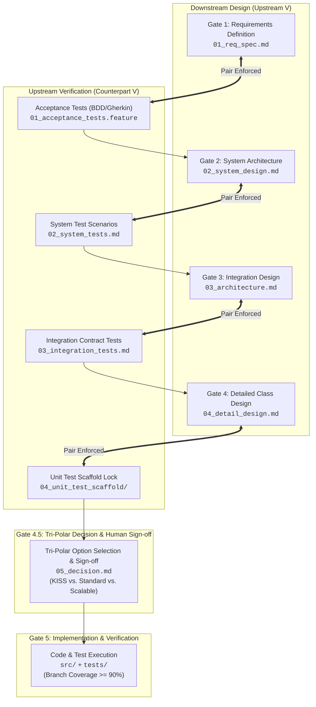
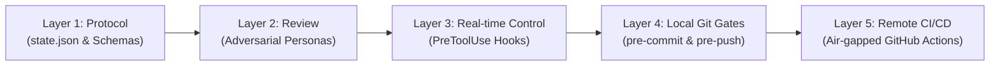

# JTC-Style AI-Driven Development Governance Platform (`jtc-gov`)

[](https://www.python.org/downloads/)
[](https://docs.astral.sh/uv/)
[](https://github.com/astral-sh/ruff)
[](https://mypy.readthedocs.io/)
[]()

> **"Uncompromising Engineering Rigor Meets Autonomous AI Development"**
> An industrial-grade, zero-trust governance platform that mechanically halts AI agent runaway, specification drift, code bloat, and self-serving test generation using symmetric V-Model gates, multi-persona red teaming, and kernel-level tool interception.

---

## 1. Executive Summary & Problem Space

While autonomous AI coding agents (Claude Code, Jules, Copilot Workspace) accelerate code production by orders of magnitude, unconstrained agents systematically exhibit five universal software engineering distortions:

| AI Distortion | Failure Mode in Unconstrained AI | Mechanical Mitigation in `jtc-gov` |
| :--- | :--- | :--- |
| **1. Tautological Testing** | AI writes buggy code and writes matching buggy tests that test nothing, yielding green CI on invalid logic. | **Scaffold Lock**: Tests and scaffolds are defined upstream in Gates 1–4 before `src/` is unlocked. AI cannot alter test assertions during implementation. |
| **2. Patch-on-Patch Decay** | AI fixes bugs with superficial try/except wrappers and monkey-patches, causing cyclomatic complexity to explode. | **Complexity Ceiling**: Ruff McCabe limit (`complexity <= 10`), max 30 statements per function, zero tolerance for print debugging (`T201`). |
| **3. Works-on-My-Machine** | AI installs undeclared system libraries or relies on unpinned transitive versions. | **Hermetic Reproducibility**: Strict `uv.lock`, Pydantic Settings environment validation, and zero implicit globals. |
| **4. Zombie / Dead Code** | AI duplicates helpers instead of refactoring existing modules, accumulating bloat. | **Vulture Zero Tolerance**: Dead code detection with confidence $\ge 80\%$ fails the build immediately. |
| **5. Mock Drift** | Mocked interfaces silently drift from external API realities. | **Contract Scaffolding**: Schema-driven test fixtures generated directly from OpenAPI/JSON Schema. |

---

## 2. Core Architecture: The Symmetric V-Model Gates

Development is partitioned into 5 rigid V-Model counterpart gates. An agent **cannot write production code** (`src/`) until Gates 1 through 4 have passed multi-persona adversarial review and received formal sign-off.



### Gate Deliverables Matrix

| Gate | Phase | Design Deliverable | Counterpart Test Deliverable | Required Review Personas |
| :--- | :--- | :--- | :--- | :--- |
| **Gate 1** | Requirements Definition | `.specs/REQ-xxx/01_req_spec.md` | `01_acceptance_tests.feature` | UX Critic, Lazy Senior Dev, FinOps/Sec |
| **Gate 2** | System Architecture | `.specs/REQ-xxx/02_system_design.md` | `02_system_tests.md` | System Architect, SRE Persona |
| **Gate 3** | Integration Design | `.specs/REQ-xxx/03_architecture.md` | `03_integration_tests.md` | Interface Architect, QA Lead |
| **Gate 4** | Detailed Class Design | `.specs/REQ-xxx/04_detail_design.md` | `04_unit_test_scaffold/` | Code Quality Critic, Security Persona |
| **Decision**| Tri-Polar Triage | `.specs/REQ-xxx/05_decision.md` | Multi-Option Trade-off Analysis | **Human Sign-Off / Negative Consensus** |

> `gov gate-check --gate 4` refuses to advance unless `05_decision.md` contains the line `HUMAN_SIGN_OFF: APPROVED`. **Known gap:** `gov draft-decision` currently writes that line itself, so the sign-off is not yet human-only. See [doc/as_is_inventory.md](doc/as_is_inventory.md) (defect A) and [doc/open_design_decisions.md](doc/open_design_decisions.md) (D3).
| **Gate 5** | Coding & Verification | `src/` (Implementation) | `tests/` (`@pytest.mark.requirement`) | Automated CI, Branch Coverage $\ge 90\%$ |

---

## 3. Four-Layer Enforcement Taxonomy

Governance rules are physically enforced across four runtime boundaries to guarantee zero-trust execution:



1. **Layer 1: Protocol & State Machine (`.specs/state.json`)**:
   Tracks the active requirement ID, current gate, and explicit whitelist of editable paths (`unlocked_paths`).
2. **Layer 2: Adversarial Red Teaming & Decision Protocol**:
   Automated single-turn review personas that produce strictly validated `gate_review.json` deliverables (max 2 fatal flaws).
3. **Layer 3: Agent Kernel Interception (`.agent/settings.json` / `PreToolUse`)**:
   Intercepts file editing tool calls (`Edit`, `Write`) in real-time. If the agent attempts to modify `src/` while `state.json` is at Gate 1–4, the tool call is rejected before execution.
4. **Layer 4: Local Git Enforcement (`pre-commit` & `pre-push`)**:
   - `pre-commit`: Blocks direct commits to `main`/`master`, executes Ruff (ALL rules), strict Mypy, Vulture, and duplicate code checks.
   - `pre-push`: Runs Pytest with $\ge 90\%$ branch coverage and enforces the **Documentation Sync Guard** (rejects `src/` diffs lacking documentation updates).
5. **Layer 5: Remote CI/CD**:
   Air-gapped, zero-credential-leakage GitHub Actions running `gov ci-verify` (bidirectional traceability of the active requirement's `REQ-xxx-Fnn` tags) and `scripts/verify_all.sh` (lint, types, dead/duplicate code, tests with coverage, pre-commit).

---

## 4. Repository Layout & Dogfooding Architecture

This repository strictly dogfoods the `jtc-gov` framework:

```text
cheeze_gyudon/
├── .agent/
│   └── settings.json                  # Real-time PreToolUse tool interception hook
├── .specs/
│   ├── state.json                     # Finite State Machine tracking active gate
│   └── REQ-2026-001/                  # Active requirement: jtc-gov Phase 1 CLI
│       ├── 01_req_spec.md             # Gate 1 Requirements & 3-pole options
│       └── 01_acceptance_tests.feature# Gate 1 BDD Acceptance test scenarios
├── doc/
│   └── jtc_governance_framework.md    # Canonical specification document (710 lines)
├── src/
│   └── jtc_gov/                       # Production governance CLI package
│       ├── __init__.py                # Package metadata
│       └── cli.py                     # Click CLI entrypoint skeleton
├── tests/
│   └── test_version.py                # Initial unit test linked to REQ-INIT-001
├── .pre-commit-config.yaml            # Ultra-strict local pre-commit & pre-push hooks
├── pyproject.toml                     # Modern uv/hatchling project configuration
├── AGENT.md                           # Universal agent constitution & guardrails
├── CLAUDE.md                          # Claude Code adapter instructions
└── README.md                          # This document
```

---

## 5. Reverse Escalation Protocol (`gov escalate`)

When an AI agent is in Gate 5 (Implementation) and discovers an insurmountable upstream specification flaw or dependency block:
1. The agent is **strictly prohibited** from patching around the problem with local hacks.
2. The agent executes `gov escalate --gate <target_gate> --reason "<detailed explanation>"`.
3. The state machine rolls back `state.json` to the target gate (e.g. `GATE1_SPEC`), immediately **re-locking** `src/` and unlocking the upstream specification file.
4. The specification and test counterpart are corrected, re-reviewed, and re-approved before `src/` can be edited again.

---

## 6. Quickstart & Local Development

### Prerequisites
- Python 3.11+
- [`uv`](https://docs.astral.sh/uv/) (Astral Python package manager)
- Git

### Setup

```bash
# 1. Clone repository
git clone https://github.com/tsuyama1990/cheeze_gyudon.git
cd cheeze_gyudon

# 2. Sync dependencies hermetically using uv
uv sync

# 3. Install pre-commit and pre-push constitution hooks
uv run pre-commit install --hook-type pre-commit --hook-type pre-push
```

### Running Checks

```bash
# Run Ruff linting and formatting
uv run ruff check --fix
uv run ruff format

# Run ultra-strict Mypy type verification
uv run mypy src tests

# Run dead code eradication check
uv run vulture src --min-confidence 80

# Run one-stop governance verification suite (Ruff, Mypy, Vulture, Duplicates, Pytest, Hooks)
bash scripts/verify_all.sh

# Run duplicate code detection
uv run python scripts/check_duplicates.py

# Test the governance CLI status and tool verification
# (`gov init` in a new project scaffolds requirement REQ-0000-001; rename it to your own REQ-YYYY-NNN)
uv run gov status
uv run gov verify-tool --file README.md
```

---

## 7. Roadmap & Next Steps

- [x] **Phase 0: Canonical Specification & Dogfooding Setup**
  - Exhaustive architecture document (`doc/jtc_governance_framework.md`)
  - Ultra-strict pre-commit and pre-push guardrails
  - Initial dogfooding state structure (`.specs/state.json`)
- [ ] **Phase 1: Core CLI & State Engine Implementation (Jules Handover)**
  - `gov init`: Scaffold `.specs/` and hook configurations
  - `gov verify-tool`: Low-latency (<50ms) tool interception engine
  - `gov gate-check`: Deliverable & schema validator across Gates 1–5
  - `gov trace-check`: AST-based bidirectional requirement traceability
  - `gov escalate`: Structured upstream rollback protocol
  - `gov audit-push`: Air-gapped push validation
- [ ] **Phase 2: Adversarial Persona Templates & Subagent Review Engine**
- [ ] **Phase 3: GitHub Actions & Air-Gapped Remote CI Integration**
- [ ] **Phase 4: Full Multi-Agent Pilot Operations**

---

## 8. License

This project is licensed under the MIT License - see the LICENSE file for details.
Phase 3 updates for PR formatting and summary generation completed.
