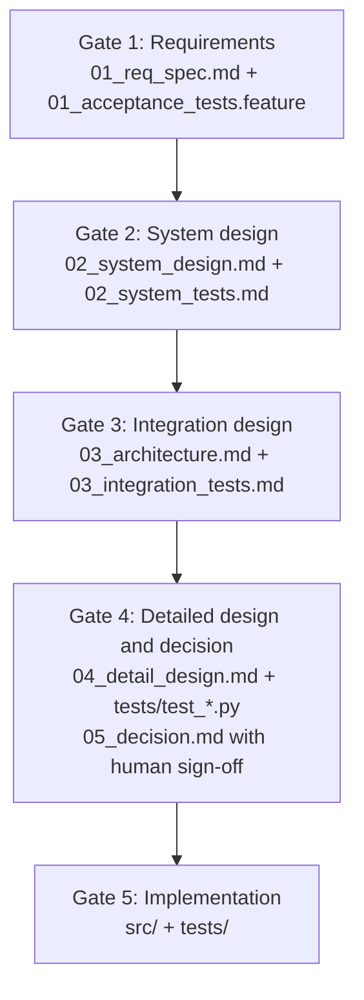

# jtc-gov

[](https://www.python.org/downloads/)
[](https://docs.astral.sh/uv/)
[](https://github.com/astral-sh/ruff)
[](https://mypy.readthedocs.io/)

A CLI and CI checks that control what an AI coding agent can merge into `main`. Development is split into 5 gates. Each gate needs a design document and its matching test specification before the next gate opens.

**Status: design in progress.** Part of what this README describes is the target design and is not enforced yet. Enforcement status measured on 2026-10-26:

- [doc/as_is_inventory.md](doc/as_is_inventory.md): what exists and what is enforced
- [doc/open_design_decisions.md](doc/open_design_decisions.md): decisions still open
- [doc/proposal_l1_flow.md](doc/proposal_l1_flow.md): proposed overall flow and spike results

---

## 1. Problems addressed

| Problem with AI agents | What exists today | Not done |
| :--- | :--- | :--- |
| **Tautological tests**: the agent writes wrong code and tests that match it | `gate-check` requires a test specification file next to each design file | Changes to test assertions are not detected |
| **Patch-on-patch**: try/except wrappers and workarounds raise complexity | Ruff McCabe limit 10, at most 30 statements per function, `print` banned (`T201`), run in CI | |
| **Works on my machine**: undeclared tools, unpinned versions | `uv.lock` is committed | Typed settings (`pydantic-settings` is a dependency but unused) |
| **Dead and duplicate code** | Vulture (confidence 80+) and `scripts/check_duplicates.py` run in CI | |
| **Mock drift**: mocks diverge from the real API | | Not implemented |

---

## 2. Gates



| Gate | Design deliverable | Test deliverable |
| :--- | :--- | :--- |
| 1 | `.specs/REQ-xxx/01_req_spec.md` | `01_acceptance_tests.feature` |
| 2 | `02_system_design.md` | `02_system_tests.md` |
| 3 | `03_architecture.md` | `03_integration_tests.md` |
| 4 | `04_detail_design.md`, `05_decision.md` | `tests/test_*.py` |
| 5 | `src/` | `tests/` with `@pytest.mark.requirement("REQ-xxx-Fnn")` |

`gov gate-check --gate N` checks that the files exist and that any reviews for the gate are APPROVED, then moves to the next gate. It does not read file contents.

Gate 4 also requires the line `HUMAN_SIGN_OFF: APPROVED` in `05_decision.md`. **Known gap:** `gov draft-decision` writes that line itself, so the sign-off is not human-only yet (defect A in [doc/as_is_inventory.md](doc/as_is_inventory.md), decision D3 in [doc/open_design_decisions.md](doc/open_design_decisions.md)).

---

## 3. What is guaranteed

Target design. The guarantee covers what reaches `main`, not what an agent does on a local machine ([rationale](doc/proposal_l1_flow.md)).

- **Guaranteed (G):** a change to `src/` cannot merge unless the decision is approved by a human on `main`; each gate has its design and test pair; spec tags and test markers match in both directions; lint, type, dead-code, duplicate-code and coverage checks pass.
- **Not guaranteed (N):** what an agent does locally before pushing, including shell writes (local hooks only advise); whether the human's approval was correct; actions by someone with admin rights or the human's credentials.
- **Assumptions (A), all unmet today:**
  - A1: the agent's credentials cannot approve or administer. Today the agent and the repository owner use the same GitHub identity.
  - A2: `main` is protected with required checks and code-owner review. Today it is not.
  - A3: CI runs a checker that the pull request cannot modify. Today a pull request can change the checker and pass (measured, proposal §6).

### Layers

| Layer | Component | Status (2026-10-26) |
| :--- | :--- | :--- |
| 1 | `.specs/state.json`: active requirement, current gate, editable paths | Works. The agent can edit it |
| 2 | Review personas (`gov redteam`) | Fixed text, no LLM call. Output cannot be read by `gate-check` |
| 3 | PreToolUse hook (`gov verify-tool`) | **Does not stop the agent.** Claude Code does not load `.agent/settings.json`, ignores the flat hook format, and treats exit code 1 as non-blocking (only exit code 2 blocks) |
| 4 | `pre-commit` and `pre-push` hooks | Defined in `.pre-commit-config.yaml`. Not installed by default; run `pre-commit install` |
| 5 | GitHub Actions: `gov ci-verify` and `scripts/verify_all.sh` | Runs on pull requests. `main` has no protection rules |

---

## 4. Repository layout

```text
.agent/settings.json        PreToolUse hook entry (not loaded by Claude Code)
.specs/state.json           active requirement and gate
.specs/REQ-2026-001/        specification of the CLI itself
.github/                    CI workflow, CODEOWNERS and ruleset templates
doc/                        specification, inventory, open decisions, proposal
src/jtc_gov/
  cli.py                    click commands
  domain/                   models and exceptions
  services/                 state, gate checks, escalation, tracing, hook decision, red team, decision draft
  scaffold/                 `gov init`
  diagnostics/              `gov doctor`
  integrations/github/      PR comment and summary formatting
tests/                      unit, e2e and distortion tests
scripts/                    verify_all.sh, check_duplicates.py, doc_sync_guard.py
AGENT.md                    rules for AI agents
CLAUDE.md                   points to AGENT.md
```

---

## 5. Escalation

If an agent in Gate 5 finds a flaw in an upstream specification, it does not work around it in code. It runs:

```bash
gov escalate --gate <target_gate> --reason "<reason>"
```

This rolls `state.json` back to the target gate, writes `.specs/<REQ>/escalations/ESC-NNN.json`, and removes the `src/` edit permission. The specification and its tests are fixed and gone through the gates again before `src/` can be edited.

---

## 6. Setup and checks

Requirements: Python 3.11+, [`uv`](https://docs.astral.sh/uv/), Git.

```bash
git clone https://github.com/tsuyama1990/cheeze_gyudon.git
cd cheeze_gyudon
uv sync
uv run pre-commit install --hook-type pre-commit --hook-type pre-push
```

```bash
bash scripts/verify_all.sh          # ruff, mypy, vulture, duplicates, pytest with coverage, pre-commit
uv run gov status                   # current requirement and gate
uv run gov verify-tool --file README.md
```

`gov init` in a new project creates the requirement `REQ-0000-001`. Rename it to your own `REQ-YYYY-NNN`.

---

## 7. Roadmap

Each phase was merged as an implementation. The gaps are listed in [doc/as_is_inventory.md](doc/as_is_inventory.md) (Sections 6 and 8).

- Phase 0: specification and dogfooding setup. Done.
- Phase 1: CLI and state engine (`init`, `verify-tool`, `gate-check`, `trace-check`, `escalate`, `audit-push`). Merged. The hook is not effective.
- Phase 2: review personas and decision draft. Merged. Review output is fixed text and incompatible with `gate-check`.
- Phase 3: GitHub Actions. Merged. `main` is not protected.
- Phase 4: `gov init` scaffolding, an end-to-end lifecycle test, and distortion tests. Merged.
- Next: settle the open decisions, then write the design documents (L1 to L3) before changing code.

---

## 8. License

MIT. See [LICENSE](LICENSE).
